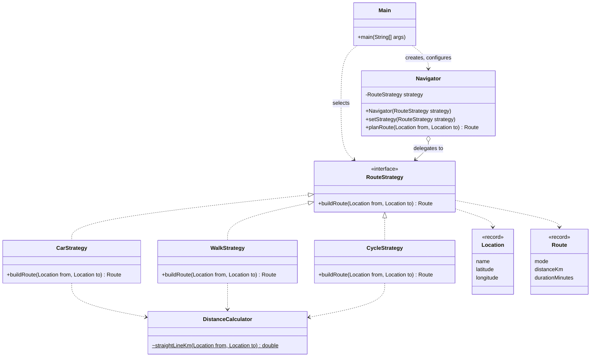

# Assignment #5 – Strategy Pattern

## 1. Introduction

Chosen domain: **Navigation / Route Planning** (Option A).

The algorithm family is "build a route between two locations". Every transport mode computes distance and travel time differently:

| Strategy | Path winding factor | Average speed |
|---|---|---|
| `CarStrategy` | 1.30 | 40 km/h |
| `WalkStrategy` | 1.15 | 5 km/h |
| `CycleStrategy` | 1.20 | 15 km/h |

`Navigator` (context) delegates planning to the current `RouteStrategy`; the client selects and switches strategies at runtime.

## 2. UML class diagram



## 3. Clean Code section

### 3.1 Polymorphism instead of conditional logic

Before:

```java
public Route planRoute(String mode, Location from, Location to) {
    switch (mode) {
        case "car":   return buildCarRoute(from, to);
        case "walk":  return buildWalkRoute(from, to);
        case "cycle": return buildCycleRoute(from, to);
        default:      throw new IllegalArgumentException(mode);
    }
}
```

After:

```java
public Route planRoute(Location from, Location to) {
    return strategy.buildRoute(from, to);
}
```

The branching on transport type is gone; the JVM picks the algorithm through dynamic dispatch.

### 3.2 Meaningful, intention-revealing names

`CarStrategy`, `WalkStrategy`, `CycleStrategy` state what they do. Methods read as sentences: `planRoute`, `buildRoute`, `straightLineKm`. Constants replace magic numbers:

```java
private static final double PATH_WINDING_FACTOR = 1.30;
private static final double AVERAGE_SPEED_KMH = 40.0;
```

### 3.3 Single Responsibility

Each strategy implements exactly one algorithm. Geometry (the haversine formula) lives separately in `DistanceCalculator`, so no strategy mixes route logic with distance math:

```java
double distanceKm = DistanceCalculator.straightLineKm(from, to) * PATH_WINDING_FACTOR;
```

### 3.4 Context is algorithm-agnostic

`Navigator` depends only on the `RouteStrategy` interface. It knows nothing about speeds, factors or concrete classes, and rejects `null` strategies:

```java
public void setStrategy(RouteStrategy strategy) {
    this.strategy = Objects.requireNonNull(strategy, "strategy must not be null");
}
```

### 3.5 Easy extensibility (Open/Closed)

Adding a new mode requires one new class and one registration line in the client:

```java
public class BusStrategy implements RouteStrategy {

    private static final String MODE_NAME = "bus";
    private static final double PATH_WINDING_FACTOR = 1.40;
    private static final double AVERAGE_SPEED_KMH = 25.0;

    @Override
    public Route buildRoute(Location from, Location to) {
        double distanceKm = DistanceCalculator.straightLineKm(from, to) * PATH_WINDING_FACTOR;
        int durationMinutes = (int) Math.round(distanceKm / AVERAGE_SPEED_KMH * 60);
        return new Route(MODE_NAME, distanceKm, durationMinutes);
    }
}
```

```java
strategies.put("bus", new BusStrategy());
```

`Navigator` and the existing strategies are untouched.

### 3.6 Immutable value objects

`Location` and `Route` are records: immutable, no setters, no hidden state shared between strategies.

## 4. Strategy vs. State

The transport mode here is chosen by the client from outside and is independent of any previous planning: every call is a self-contained computation, and strategies know nothing about each other. That is Strategy. State would fit if the `Navigator` itself changed behavior as its internal condition evolved and the concrete states triggered transitions to other states (for example, a navigator moving through `Idle -> Navigating -> Rerouting -> Arrived`). In Strategy the client switches the algorithm; in State the object switches its own behavior.

## 5. Conclusion

Four small classes (interface plus three strategies) replace a growing conditional block. The cost is a few extra files; the gain is that new transport modes are added without modifying tested code, each algorithm can be unit-tested in isolation, and the strategy can be swapped at runtime.
